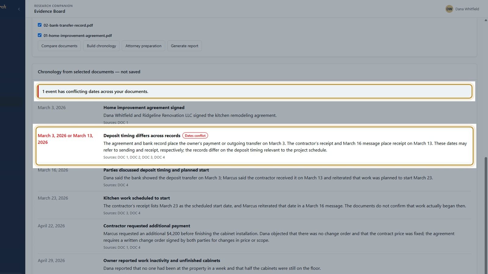

# LOCKE RESEARCH COMPANION
### The research is useful. The connected case record makes it actionable.

**Product engineering portfolio · November 13, 2026**  
**For future software-development clients, hiring managers and engineering evaluators.**

[**LIVE PRODUCT**](https://lockeresearchcompanion.com/) · [**LAUNCH TEASER**](assets/research-companion-launch-teaser.mp4) · [**FULL COMPARISON**](COMPARISON.md)

---

## From a legal question to organized, traceable work

An isolated chatbot answer is not a case-preparation workflow. Locke Research Companion connects **the question, jurisdiction, court hierarchy, retrieved sources, uploaded documents, facts, dates, issues and attorney-preparation work** in one matter-centered environment.

Users can orient quickly, request retrieved-source-backed answers, or run deeper research. Private document analysis, OCR correction, multi-document synthesis, evidence tracking, and report export make the product more than a search box.

## Six proof points for an engineering portfolio

| **01 — Jurisdiction-aware legal research** | CourtListener case law, Congress.gov federal statutes and bills, eCFR, search-derived state code links, verified court grouping for 50 states/DC/federal |
|---|---|
| **02 — Source-aware Ask Locke** | Chat history, optional depth, follow-up questions, citation and private-document links, and sourced-answer auditing before display |
| **03 — Structured case records** | Create/archive/restore case files; connect documents, jurisdiction, timeline events, facts, issues and verification flags |
| **04 — Document intelligence** | PDF/DOCX import, text extraction, local OCR, page correction/acceptance, document summaries and issue/date/fact suggestions |
| **05 — Prepared work product** | Attorney-preparation packets, multi-document chronology and review, deep case synthesis, PDF and Word reports |
| **06 — Production software** | React/TypeScript experience, Express/PostgreSQL APIs, JWT sessions, tenant-scoped data, model routing, quota accounting and red-team remediations |

## The key engineering decision

**Source-Backed and Deep answers are not displayed until the application's citation audit completes.** Quick answers can stream as orientation. That boundary reduces the risk of presenting a source-claiming answer that the system later rejects, while preserving a faster mode when the user does not request verified retrieval.

The audit **does not** substitute for legal proposition/quotation verification, case-negative-treatment research, Shepard's, KeyCite, or professional judgment. The team evaluating the product can see precisely where the current boundary sits.

## Why the product is worth evaluating

It demonstrates the ability to build a domain-specific application with an integrated front end, persistent state, multiple retrieval sources, transparent limitations, structured evidence, asynchronous document work and controlled AI outputs.

The comprehensive register covers **381 individual entries**, the route inventory traces **102 HTTP operations**, and the Ask Locke investigation contains **49 separately named behaviors**.

[**View every inspected feature**](FEATURE-MATRIX.md) · [**Ask Locke deep dive**](ASK-LOCKE.md)

## Five-competitor positioning

The assessment uses **Lexis+ with Protégé, CoCounsel Legal/Westlaw Advantage, vLex Vincent, Bloomberg Law and Paxton AI**, all in their current AI-enabled forms.

Their licensed legal-content collections, citators, advanced agents and editorial depth are significant advantages. Locke's strongest demonstrable positioning is the **composition of source-aware research with private case-document and evidence workflows**, plus engineering that makes the limitations of each research mode visible.

[**Read the full 51-row comparison**](COMPARISON.md)

## See the real product

[**Watch the 40-second launch teaser**](assets/research-companion-launch-teaser.mp4)

## Delivered source and release

The private production application at commit a05e53d886fd is recorded as deployed successfully on Railway with passing GitHub CI. The November 12 handoff records security and reliability remediations; this publication did not rerun tests or expose private security details.

For a prospective engineering employer, the value is the demonstrated **end-to-end implementation**. For a software-development client, it is the ability to translate complex legal work into a persistent, usable and carefully bounded software product.

**[Product homepage](https://lockeresearchcompanion.com/)** · **[Status qualifications](VERIFICATION-AND-STATUS.md)** · **[Technical source trace](ROUTE-TRACE.md)**

---

*Locke Research Companion provides research assistance and case organization, not legal advice. No independent claim of greater legal accuracy, richer source coverage, or superior citation verification is made.*
