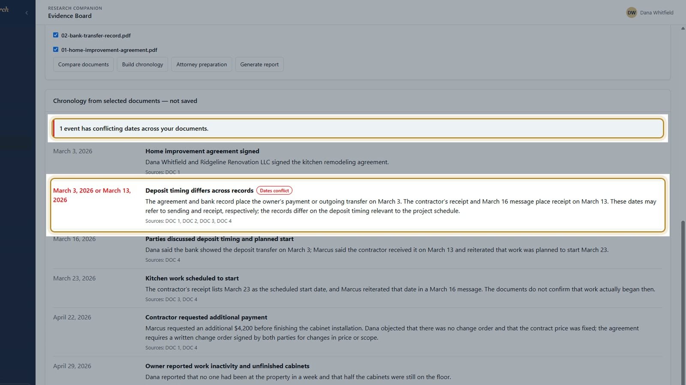

# Locke Research Companion — Launch teaser

**[Play the 40-second launch teaser (MP4)](assets/research-companion-launch-teaser.mp4)**

**[Visit the live research product](https://lockeresearchcompanion.com/)** · **[See source-backed research explained](https://lockeresearchcompanion.com/source-backed)**

A 40-second launch teaser on real screens from the live product, using a fictional Ohio contractor-dispute case. It shows what sets Research Companion apart: research scoped to the state and court with every citation checked against its source, documents that stay connected to the matter, conflicting dates flagged across records instead of silently picked, and attorney-ready preparation built from the case file. The MP4 is stored in this repository.

[Portfolio brochure](BROCHURE.md) · [51-row comparison](COMPARISON.md) · [Every feature](FEATURE-MATRIX.md)
