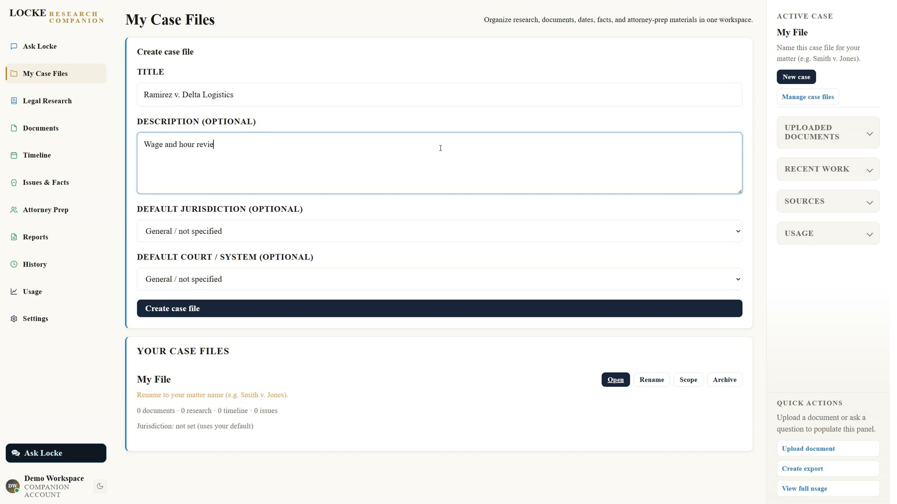

<h1 align="center">LOCKE RESEARCH COMPANION</h1>

<strong>Legal research that stays connected to your case.</strong>

<em>Source-aware AI, document intelligence, evidence organization and attorney preparation — an engineering portfolio by Locke Development.</em>

<a href="https://lockeresearchcompanion.com/">Live product</a> ·
<a href="BROCHURE.md">Portfolio brochure</a> ·
<a href="COMPARISON.md">Competitive comparison</a> ·
<a href="FEATURE-MATRIX.md">381-feature inventory</a> ·
<a href="ASK-LOCKE.md">Ask Locke</a> ·
<a href="DEMO.md">Video demonstration</a>

---

## One question. One case record. Connected work.

Locke Research Companion is a deployed legal research and case-preparation application that connects jurisdiction-aware research with stored documents, legal citations, chronology, facts, issues, evidence, attorney preparation and final reports.

Rather than presenting an AI answer as a standalone chat artifact, the product carries research into a **structured case file**. Source-Backed and Deep research outputs must clear the application's **retrieved-source citation audit** before they appear to the user; Quick answers remain available for streaming orientation.

**The engineering distinction is the complete, connected workflow and transparent source limitations**, not an unsupported claim to more comprehensive legal authority than Lexis, Westlaw or other established research libraries.

## Watch the actual software

**[Watch the original narrated video](https://lockeresearchcompanion.com/media/locke-research-companion-demo.mp4)** · **[Explore the live product](https://lockeresearchcompanion.com/)**

The original website poster is preserved in this repository; the official video plays from the live website.

## What this build demonstrates

| Product area | Verified architecture and workflow |
|---|---|
| **Ask Locke** | Quick/Source-Backed modes, multi-turn history, jurisdiction awareness, retrieved citations, document citations and follow-up prompts |
| **Primary-source research** | CourtListener case law, federal law through Congress.gov, regulations via eCFR, and search-derived state-statute links |
| **Citations before display** | Sourced answers withheld when the current audit cannot match asserted citations against retrieved records |
| **Case files** | Matter-level jurisdiction, court, document associations, evidence, issues and facts |
| **Documents & OCR** | PDF/DOCX/text imports, scanned-page OCR, correction/acceptance, source retention |
| **Chronology & evidence** | Extracted dates, cross-document timeline, issue and fact verification records |
| **Attorney preparation** | Preparatory questions, reports, deep case review, full case packets and export |
| **Software engineering** | Node.js, Express, React/TypeScript, PostgreSQL, AI routing/failover, rate and usage controls, scoped JWT auth, release checks |

## Every feature was traced individually

- **381 individual entries** across 18 functional areas, including clearly identified features **not shipped**: [Feature Matrix, Part 1](FEATURE-MATRIX.md) and [Part 2](FEATURE-MATRIX-2.md).
- **102 API route operations**, traced across all eight Express route modules: [Route Trace](ROUTE-TRACE.md).
- **49 Ask Locke behaviors** examined individually: [Ask Locke Deep Dive](ASK-LOCKE.md).
- **51 competitive side-by-side checks** against Lexis+ with Protégé, CoCounsel Legal/Westlaw, vLex Vincent, Bloomberg Law and Paxton AI: [Comparison](COMPARISON.md).

These are **source-level examinations**, not 381 separately executed tests or independent commercial outcome benchmarks.

## A defensible case for future employers and development clients

**Applied AI:** retrieval orchestration, multi-model integration, document grounding, output checks, source-warning interfaces and controlled streaming.

**Application architecture:** persistent case state, evidence workflows, document processing, durable OCR jobs, quotas, session protection and auditing.

**Product judgment:** acknowledge unknown law, distinguish search-derived statutes from primary-text ingestion, and block source-backed output that fails its evidence matching.

Read the [market brochure](BROCHURE.md), [citation limitations](CITATION-AND-SOURCES.md), [verification status](VERIFICATION-AND-STATUS.md) and [methodology](METHODOLOGY.md).

**Pricing is not set** in the current product catalog; internal model values are not public offers. The inspected private application is recorded as successfully deployed on Railway at commit a05e53d886fd.

---

Locke Research Companion is legal-information and document-organization software, not a law firm or substitute for attorney advice. AI content and cited legal propositions require independent professional verification. Proprietary source code and private customer data are not included in this public portfolio.
